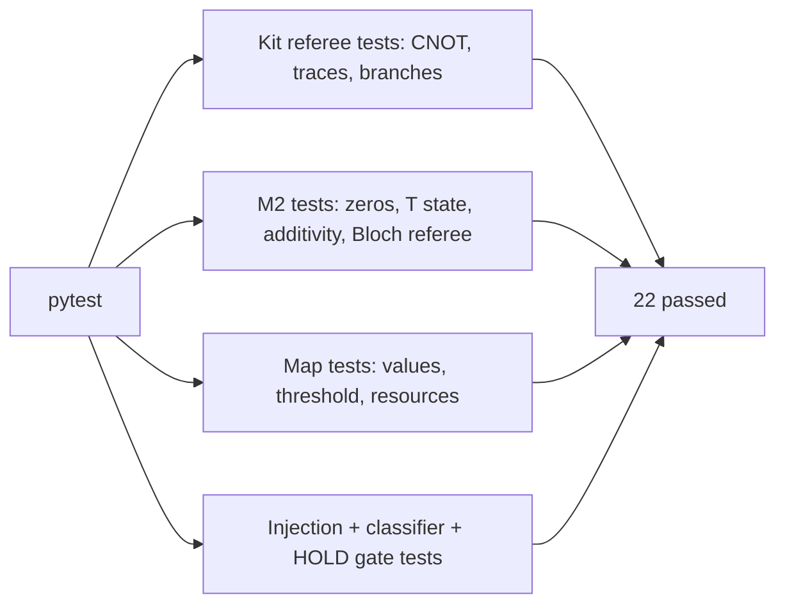
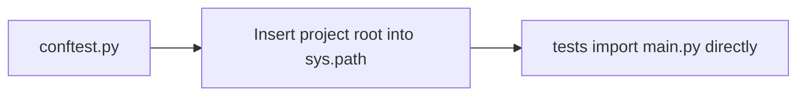
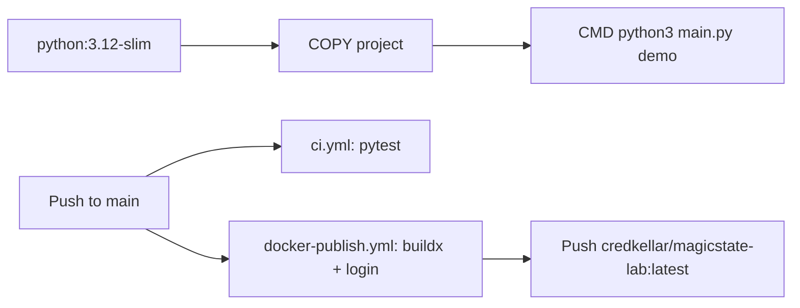

# MagicState-Lab ✨⚛️

**Magic State Lab — Stabilizer Rényi Entropy, the Bravyi–Kitaev 15-to-1 Distillation Map, and T-Gate Injection** — by Darion Kellar

MagicState-Lab is an **educational magic state lab** in ONE pure-Python file. It starts from the question fault tolerance actually turns on: Clifford operations are cheap, so the resource that makes a quantum computer universal is **magic** — and magic can be *measured*. For pure states of one and two qubits the lab builds the density matrix, measures **every Pauli expectation value from the state itself**, and evaluates the **stabilizer Rényi entropy M2**. Stabilizer states (|0⟩, |+⟩, |+i⟩, the Bell state) come out at **M2 = 0**; the T state |T⟩ = (|0⟩ + e^{iπ/4}|1⟩)/√2 comes out at **M2 = −log2(3/4) = 0.415037499279** — computed, then graded against the closed form. ✨

Then the lab follows the magic: noisy T states are cleaned by **distillation** and spent by **injection**. Distillation is presented with its honesty label attached — the lab applies the Bravyi–Kitaev 15-to-1 protocol's known leading-order error map **p → 35p³** exactly as a map (the 15-qubit Reed–Muller circuit is *not* simulated qubit-by-qubit), iterates it below and above its threshold, and locates that threshold by bisection at **p\* = 0.169030850946 = 1/√35**. Injection, by contrast, *is* simulated in full: the two-qubit gate-teleportation circuit (CNOT, measure, S correction) runs on density matrices with both branches carried exactly, and the output infidelity is printed for two noise models — **ε_out = p/2** under depolarizing noise, **ε_out = p** under phase-flip noise. 🔬

Honest scope, stated up front: every number is exact arithmetic on labelled teaching models. Nothing here distills a state on real hardware, certifies a device's error rate, or builds a fault-tolerant computer. Every real-world use sits behind a permanent HOLD gate (14 total). 🔒

[](https://github.com/kimanicollier44-cmyk/MagicState-Lab/actions/workflows/ci.yml)
[](https://github.com/kimanicollier44-cmyk/MagicState-Lab/actions/workflows/docker-publish.yml)

> ℹ️ These are the **live** workflow badges for this repo. They activate as soon as the `ci.yml` and `docker-publish.yml` files from the paste pack are pasted into `.github/workflows/` — until then they have nothing to report yet.

## 🧰 Tech Stack Badges & Full Architecture Tech Stack

### 💻 Core Programming Languages & Core Systems


%20%3D%200.169031-2ea44f)

- 🐍 Python 3.12, pure standard library (`math`, `hashlib`, `itertools`, `json`, `sys`) — zero dependencies, zero network, deterministic (double-run byte-identical)
- ⚛️ Density-matrix core from scratch: a complex matrix kit (products, daggers, Kronecker products), unitary conjugation UρU†, exact projective measurement with both branches carried, and partial traces — refereed against the CNOT truth table and product-state traces before any lab number trusts it
- ✨ Stabilizer Rényi entropy: M2 = −log2((1/2ⁿ) Σ_P |⟨P⟩|⁴) over all 4ⁿ Pauli strings, cross-graded against the independent Bloch-vector closed form 1 + x⁴ + y⁴ + z⁴ on 20 tilted states
- 🧪 Distillation as a map: p → 35p³ iterated in the open, threshold bisected on the map itself, overhead counted as 15^rounds raw states
- 🔀 Injection as a circuit: CNOT (data → ancilla), Z measurement, S correction (the identity S·T† = T is itself a check), branch probabilities exactly 1/2
- 🧠 TinyML kNN supply classifier (from scratch, stdlib, distance-weighted): no-magic / inject-ready / distill-first / above-threshold from (M2, log₁₀ p), labels from the lab's own policy
- 🪑 Council seats: Gemini Argon 4 DECIDER (names-only, tighten-only) + Muse advisor (never overrides HOLD) + Google Flow plan-only (rendered = False, live = 0)

### ⛓️ Web3 & Infrastructure

- 🚫 **Not applicable — honestly.** No blockchain, no Web3, no tokens: the "infrastructure" in this lab is density-matrix arithmetic on one and two qubits inside one offline file. Real-hardware injection and distillation are permanent HOLD gates, not features. No fake badges here.

### ⚙️ Platform Support & Hardware Architecture


- 🖥️ Pure Python — runs anywhere Python 3.12+ runs (Linux, macOS, Windows), plus the `python:3.12-slim` Docker image
- 🔒 No hardware is controlled, ever: real processors, state injectors, and distillation factories are permanent HOLD gates (see the gate table below)

### ⚡ Low-Level Infrastructure & Performance

- 🚫 **No low-level code — honestly.** No C, no C++, no GPU, no compiled extensions: this is one interpreted Python file on purpose, so every expectation value can be read, checked, and diffed. Performance here means honest algorithms — exact branch-carrying measurement instead of Monte Carlo sampling, and a bisection that grades the threshold against 1/√35 — all deterministic and byte-identical between runs.

### 🛠️ DevOps & Build Tools


- 🐳 Docker (`python:3.12-slim`), GitHub Actions CI + Docker Publish (delivered in the paste pack)
- 🎯 Target image: `credkellar/magicstate-lab:latest`
- 🧪 Tests: `pytest` (22 tests) + the built-in CHECKS suite (49 checks) in `main.py`

### ☁️ Cloud Providers

- 🚫 **None — honestly.** No cloud provider is used or needed: the lab runs fully offline on your own machine or in a local Docker container. Docker Hub appears only as the registry the publish workflow pushes the image to.

## What this does?

1. 🧮 **Density-matrix kit, refereed first** — the CNOT gate is built basis-state by basis-state and checked against its truth table; partial traces are checked on product states; every battery state's density matrix is checked trace-one and Hermitian; the S-correction identity S·T† = T is verified as matrices — *before* any of it is trusted with a fidelity.
2. ✨ **Pauli expectations from the state** — for each state the lab forms ρ = |ψ⟩⟨ψ| and computes ⟨P⟩ = Tr(ρP) for every Pauli string (4 strings for one qubit, 16 for two). |0⟩ returns (I, X, Y, Z) = (1, 0, 0, 1) exactly; the T state's distribution is (1, 1/√2, 1/√2, 0), normalised as a probability distribution over strings.
3. 🎯 **Stabilizer states score zero** — |0⟩, |1⟩, |+⟩, |+i⟩, |++⟩, and the Bell state all return **M2 = 0 to within 1e-9**: exactly 2ⁿ Pauli strings saturate |⟨P⟩| = 1 and the rest vanish, which is the stabilizer signature the entropy is built to detect.
4. ✨ **The T state, graded** — M2(|T⟩) computes to **0.415037499279**, matching −log2(3/4) to 1e-12. The H-type state cos(π/8)|0⟩ + sin(π/8)|1⟩ scores the same 0.415037499279, and the body-diagonal state (Bloch vector (1,1,1)/√3) scores **log2(3/2) = 0.584962500721** — three different magic states, three closed forms, three matches.
5. ➕ **M2 is additive, and the lab proves it on tensor products** — |T⟩⊗|0⟩ scores 0.415037499279 (the stabilizer factor adds nothing) and |T⟩⊗|T⟩ scores **0.830074998558 = 2 × 0.415037499279**: magic counts resources, and two T states carry exactly twice the magic of one.
6. 🗺️ **A referee for the entropy itself** — for one qubit, Σ_P |⟨P⟩|⁴ = 1 + x⁴ + y⁴ + z⁴ in Bloch components, an independent closed form. CHECKS grades the full Pauli-sum implementation against it on 20 tilted states (θ ∈ {20°…170°} × φ ∈ {0°…200°}) — agreement to 1e-12 everywhere, so the entropy is believed because two different computations agree.
7. 🧪 **The distillation map, iterated in the open** — from p₀ = 0.10: 0.10 → 0.035 → 0.001500625 → 1.182727e-07 → 5.79e-20 → 6.80e-57. The cubic map compounds into doubly-exponential collapse, and the lab prints every round instead of quoting the exponent. From p₀ = 0.10 the map reaches 1e-6 in **3 rounds (15³ = 3,375 raw states)** and 1e-12 in **4 rounds (50,625 raw states)** — the overhead is 15^rounds by the map's own combinatorics.
8. 🚦 **The threshold, located not quoted** — bisection on f(p) = 35p³ − p finds the fixed point at **0.169030850946**, matching 1/√35 to 1e-9. Above it the same map amplifies: 0.25 → 0.546875 → 5.724430 — the "distilled" state is worse than the input, and the lab prints the blow-up and says plainly that the polynomial has left the small-p regime where it means anything.
9. 🔀 **Injection, simulated for real** — data |+⟩ plus a perfect |T⟩ ancilla: CNOT, measure, correct — the output density matrix *is* |T⟩⟨T| to 1e-12, branch probabilities exactly 1/2 each. The magic moves from the ancilla into the data, and at p = 0 the transfer is lossless.
10. 📉 **Error transfer, both models printed** — with depolarizing ancilla noise ρ_A = (1−p)|T⟩⟨T| + p·I/2, the output infidelity is **ε_out = p/2 exactly** (p = 0.20 → 0.10): the raw noise rate is halved at first order, and ε_out equals the resource's own infidelity p/2 — transferred, not magicked away. With phase-flip noise the full **ε_out = p** passes straight through. The classifier then routes supply batches (no-magic / inject-ready / distill-first / above-threshold) from the lab's own computed M2 and the threshold, with Argon 4 DECIDER (sha256 trace), Muse advisor, Google Flow plan-only, and a built-in CHECKS suite (49 checks).

## 🗺️ How it works — diagram per script

### `main.py` — the whole lab

```mermaid
flowchart TD
    A[CLI: demo / checks / magic / distill / inject] --> B[Density-matrix kit: conjugation, branches, partial trace]
    B --> C[Pauli expectations Tr(rho P) for all strings]
    C --> D[M2: stabilizer Renyi entropy]
    D --> E[Stabilizer states: M2 = 0]
    D --> F[T state: M2 = -log2(3/4)]
    D --> G[Additivity: T x T doubles M2]
    H[Distillation MAP p -> 35 p^3] --> I[Below threshold: doubly-exponential fall]
    H --> J[Threshold: bisection vs 1/sqrt(35)]
    H --> K[Above threshold: error grows]
    B --> L[Injection circuit: CNOT, measure, S correct]
    L --> M[Depolarizing: eps_out = p/2]
    L --> N[Phase-flip: eps_out = p]
    I --> O[kNN Supply Classifier]
    M --> O
    O --> P[Argon 4 DECIDER + Claude Advisor]
    P --> Q{HOLD Gates x14}
    Q -->|hardware / certification claims| R[HOLD - exit 2]
    Q -->|sandbox sim| S[CHECKS + VERDICT PROCEED]
```

### `tests/test_main.py` — verification



### `conftest.py` — test path setup



### `Dockerfile` + CI flow — container & publish



## Why is this cool?

1. ✨ Magic is **measured, not vibes**: M2 comes out of the state's own Pauli expectations, and the T state's 0.415037499279 is graded against −log2(3/4) to twelve decimal places.
2. 🎯 The stabilizer zeros are **exact**: six different stabilizer states — including an entangled Bell state — all land on M2 = 0, which is the whole point of the monotone: entanglement alone is not magic.
3. ➕ Additivity is **demonstrated, not assumed**: |T⟩⊗|T⟩ doubles the entropy and |T⟩⊗|0⟩ doesn't move it — the resource-counting property that makes M2 useful, shown on computed numbers.
4. 🗺️ The entropy implementation is **refereed by a second formula**: the Bloch closed form 1 + x⁴ + y⁴ + z⁴ agrees with the 4ⁿ-string Pauli sum on 20 tilted states to 1e-12.
5. 🧪 The distillation fall is **doubly exponential and printed round by round**: 0.10 → 0.035 → 0.0015 → 1.18e-07 → 5.79e-20 — five rounds from sloppy to absurd, each one a single line of arithmetic you can redo by hand.
6. 🚦 The threshold is **found, not quoted**: bisection on the map lands on 1/√35 to nine decimal places, and the above-threshold blow-up (0.25 → 5.72) is printed with its health warning instead of being hidden.
7. 🔀 Injection is a **real circuit run**: both measurement branches carried exactly on density matrices, the S correction verified as a matrix identity, and the perfect case returning |T⟩⟨T| itself — the magic physically moves qubits.
8. 📉 The error story is **honest in both directions**: depolarizing noise is halved (ε_out = p/2), phase-flip noise is not (ε_out = p) — the lab prints the model where its headline fails, next to the one where it holds.
9. 🏷️ The classifier's labels come from the lab's **own policy** (M2 gate + the computed threshold), and the test suite asserts the kNN agrees with that policy on every one of the 36 grid points — no hand-labelled training data.
10. 🎯 Deterministic end to end: no sampling anywhere — measurement branches are carried with their probabilities — so run it twice, get byte-identical output.

## What problems this solves?

1. ❌ **Problem:** "Magic" is invoked as a slogan for why quantum computers are powerful. ✅ **Solution:** It is given a number — M2 from Pauli expectations — with stabilizer states at exactly 0 and |T⟩ at −log2(3/4), all recomputed from the density matrix.
2. ❌ **Problem:** Entanglement and magic are conflated; a Bell state gets called "maximally quantum". ✅ **Solution:** The Bell state scores M2 = 0 in this lab — it is a stabilizer state, simulable by Gottesman–Knill — while the product state |T⟩⊗|T⟩ scores 0.830075. The distinction is a computed number, not a paragraph.
3. ❌ **Problem:** Distillation is described as if the full 15-qubit protocol were being run in demos. ✅ **Solution:** The lab states in its first section, its demo, and its gate table that it applies the protocol's error *map* p → 35p³ exactly and does **not** simulate the Reed–Muller circuit qubit-by-qubit.
4. ❌ **Problem:** Threshold numbers (p\* ≈ 0.169) are quoted from papers and believed. ✅ **Solution:** The fixed point is bisected out of the map itself and graded against 1/√35 — believed because recomputed.
5. ❌ **Problem:** "Below threshold" is treated as a vibe rather than a cliff edge. ✅ **Solution:** Both sides are iterated in the open: below, doubly-exponential collapse; above, the error *grows* round over round until the polynomial leaves its regime — the cliff is a printed table.
6. ❌ **Problem:** Overhead numbers (15^k) get laundered into roadmaps and timelines. ✅ **Solution:** The counts are printed as combinatorics of a stated map — 3,375 raw states to 1e-6, 50,625 to 1e-12 — and `resource_forecast_claim` is a permanent HOLD gate.
7. ❌ **Problem:** Injection demos quietly assume perfect magic states. ✅ **Solution:** The ancilla is noisy under two stated models, both branches are carried exactly, and the output infidelity is printed against p for each — including the model (phase-flip) where nothing is suppressed.
8. ❌ **Problem:** "Error suppression" gets claimed from a single favourable noise model. ✅ **Solution:** ε_out = p/2 (depolarizing) and ε_out = p (phase-flip) sit in the same table, with the note that under depolarizing noise ε_out equals the resource's own infidelity — transferred at half the raw rate, not eliminated.
9. ❌ **Problem:** Measurement in small simulations is done by coin flips, making outputs irreproducible. ✅ **Solution:** Branches are carried with their exact probabilities (1/2 and 1/2, asserted) and mixed at the end — the demo is byte-identical between runs.
10. ❌ **Problem:** Magic-state numbers get laundered into fault-tolerance claims and device certifications. ✅ **Solution:** `fault_tolerant_computer_claim`, `real_device_error_rate_certification`, and 12 sibling HOLD gates return exit code 2 for every real-world use, permanently.

## How to install this?

1. 📋 Clone or download this project folder.
2. 🐍 Make sure Python 3.12+ is installed: `python3 --version`
3. ▶️ Run the full demo + checks (no arguments needed):

```bash
python3 main.py
```

4. 🧪 Run the test suite:

```bash
pip install pytest
python3 -m pytest -q
```

5. 🎛️ Try the other commands:

```bash
python3 main.py checks      # 49 built-in checks
python3 main.py magic       # M2 battery: computed vs analytic (JSON)
python3 main.py distill     # the 35 p^3 map: threshold, rounds, overhead (JSON)
python3 main.py inject      # injection fidelity vs p, both noise models (JSON)
python3 main.py threshold   # bisected fixed point vs 1/sqrt(35) (JSON)
python3 main.py classify    # kNN supply classifier report
python3 main.py brains      # Argon 4 + Muse + Flow seats
python3 main.py holds       # list all 14 HOLD gates
python3 main.py hold-demo   # exits 2 - gated actions stay HOLD
```

6. 🐳 Or run it in Docker:

```bash
docker build -t credkellar/magicstate-lab:latest .
docker run --rm credkellar/magicstate-lab:latest
```

## Requirements

- 🐍 Python 3.12 or newer
- 📦 Dependencies: **none** (standard library only)
- 🌐 Network: **none** — fully offline
- 🧪 For tests only: `pytest`
- 🐳 Optional: Docker

## FULL project structure tree

```text
magicstate-lab/
├── main.py                  # the whole lab: density-matrix kit, Pauli expectations, M2, distillation map + threshold, injection circuit, classifier, seats, HOLD gates
├── conftest.py              # puts the project root on sys.path for tests
├── tests/
│   └── test_main.py         # 22 pytest tests: kit referees, M2 battery, map + threshold, injection, gates, determinism
├── assets/
│   └── cover.png            # README cover image (2736 x 912)
├── Dockerfile               # python:3.12-slim, runs the demo
├── .gitignore               # __pycache__/, .pytest_cache/, *.pyc
└── README.md                # this file
```

> 📦 Delivered separately as paste packs (not in this tree): `.github/workflows/ci.yml` + `docker-publish.yml`, and the Docker Hub pack (100-char description, 350-char About, overview, categories).

## 🔒 HOLD gates — all 14, permanent

| # | Gate | What stays held |
|---|------|-----------------|
| 1 | `fault_tolerant_computer_claim` | No claim a working fault-tolerant quantum computer exists or was built from this arithmetic |
| 2 | `real_hardware_distillation_claim` | No claim distillation ran on real hardware; the map is applied, the circuit is not run |
| 3 | `real_device_error_rate_certification` | No certifying a real device's error rate or threshold position from this model |
| 4 | `quantum_advantage_certification` | No certifying quantum advantage for any device, algorithm, or vendor |
| 5 | `cryptographic_breakthrough_claim` | No claim resource arithmetic here breaks or times any real cryptosystem |
| 6 | `resource_forecast_claim` | 15^k overhead counts are combinatorics, not forecasts, roadmaps, or timelines |
| 7 | `live_hardware_state_injection` | No injecting states or controlling hardware outside this simulation |
| 8 | `distillation_guarantee_claim` | The leading-order map has O(p⁵) corrections; it guarantees nothing for a real run |
| 9 | `magic_state_superiority_claim` | No claim one lab's or vendor's magic states are better from this arithmetic |
| 10 | `product_benchmark_claim` | No product benchmark or marketing figure from lab numbers |
| 11 | `investment_claim` | No investment claims; a lab model is not a prospectus |
| 12 | `simulation_as_measurement_claim` | Simulated entropies and fidelities must never be presented as measured device data |
| 13 | `medical_quantum_claim` | No medical, imaging, or therapy claims from magic state arithmetic |
| 14 | `standards_compliance_claim` | No claim of compliance with any fault-tolerance or benchmarking standard |

🧑‍⚖️ **Council seats:** Gemini Argon 4 Extended Thinking — DECIDER (names-only, tighten-only, MAP → MODEL → STRESS → DECIDE, sha256 trace, `can_override_hold = False`) · Muse — advisor (`can_override_hold = False`) · Google Flow — plan-only (`rendered = False`, `live = 0`).

✅ **Verification:** pytest **22 passed** (project + clean copy) · built-in CHECKS **49/49** · double-run output **byte-identical** · `hold-demo` exits **2** · `main.py` **965 lines**, pure stdlib, zero network.

## 🧒 5th-grade English section

Imagine a box of building blocks that can only snap together in a few simple ways. Those simple snaps are called Clifford operations, and a computer that only has them is surprisingly weak — a normal laptop can pretend to be one. 🧱

- To make the quantum computer truly powerful, you need a few **magic blocks** — special pieces that don't follow the simple snapping rules. This lab can *count* how much magic is inside a piece, using a score called M2. Plain pieces score **0**. The most famous magic piece, called the T state, scores **0.415**. ✨
- Magic pieces come out of the factory a bit dirty — each one has a small chance **p** of being wrong. **Distillation** is a washing machine for them: put 15 dirty pieces in, get 1 cleaner piece out. If the pieces start clean enough (p below about **0.169**), each wash makes the error shrink super fast: 0.10 → 0.035 → 0.0015 → almost nothing. If they start too dirty, the washing makes things *worse* — the lab shows both sides honestly. 🧺
- **Injection** is how you spend a magic piece: you teleport its magic into the piece you're actually computing with, using a little circuit with a measurement in the middle. This lab runs that circuit for real, on paper-sized math, and checks exactly how much dirt survives — sometimes half of it, sometimes all of it, depending on the kind of dirt. 🔀
- This project is a **pretend lab on a computer**. It does not build a real quantum computer. It teaches how scientists count magic, wash it clean, and spend it — with every number shown. 💻

---

MIT © 2026 Darion Kellar · MagicState-Lab — educational simulation only ✨
